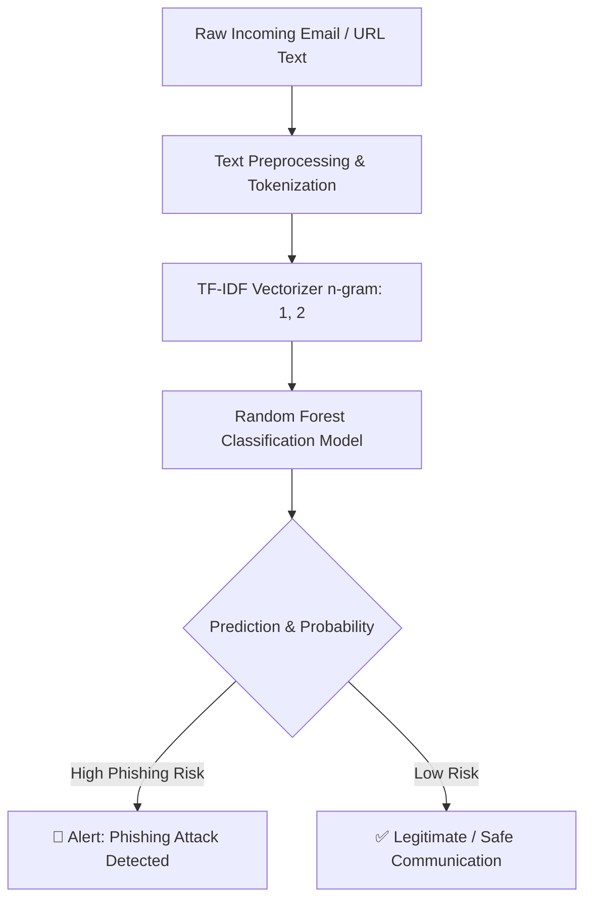

# 🛡️ AI Phishing Detector (NLP & Machine Learning)

[](https://www.python.org/)
[](https://scikit-learn.org/)
[](#)
[](https://opensource.org/licenses/MIT)

An intelligent, lightweight NLP-driven security tool designed to detect phishing emails, deceptive messages, and malicious links using **TF-IDF Feature Extraction** and **Random Forest Classification**.

---

## 🚀 Key Features
- **Natural Language Processing (NLP):** Utilizes `TF-IDF (Term Frequency-Inverse Document Frequency)` with n-grams `(1, 2)` to capture malicious keywords and deceptive phrasing patterns.
- **Machine Learning Classification:** Powered by a tuned `Random Forest Classifier` capable of high-precision classification.
- **Evaluation Metrics Focused on Cybersecurity:** Calculates **Precision**, **Recall**, and **F1-Score** to minimize false positives and eliminate dangerous false negatives.
- **Multi-lingual Support:** Handles both English and Turkish phishing heuristics.

---

## 🧠 Architecture Overview



---

## 🛠️ Installation & Setup

1. **Clone the repository:**
   ```bash
   git clone https://github.com/your-username/AI-Phishing-Detector.git
   cd AI-Phishing-Detector
   ```

2. **Create and activate a virtual environment:**
   ```bash
   python -m venv venv
   # Windows:
   venv\Scripts\activate
   # Linux / macOS:
   source venv/bin/activate
   ```

3. **Install dependencies:**
   ```bash
   pip install -r requirements.txt
   ```

4. **Run the detector:**
   ```bash
   python detector.py
   ```

---

## 📊 Sample Output
```text
=== Model Başarı Metrikleri ===
Accuracy : %100.00
Precision: %100.00
Recall   : %100.00

=== Örnek Canlı Tahminler ===

[Girdi]: "Your account is locked! Click http://fake-bank-auth.com immediately to unlock."
[Sonuç]: 🚨 TEHLİKE: PHISHING! (Güven Skoru: %98.0)

[Girdi]: "Hey team, the slide deck for tomorrow's presentation is ready for review."
[Sonuç]: ✅ GÜVENLİ: NORMAL METİN (Güven Skoru: %99.0)
```

---

## 👨‍💻 Author & Contributions
Developed for research and practical defense in cybersecurity & machine learning applications.  
Open for contributions and PRs!
